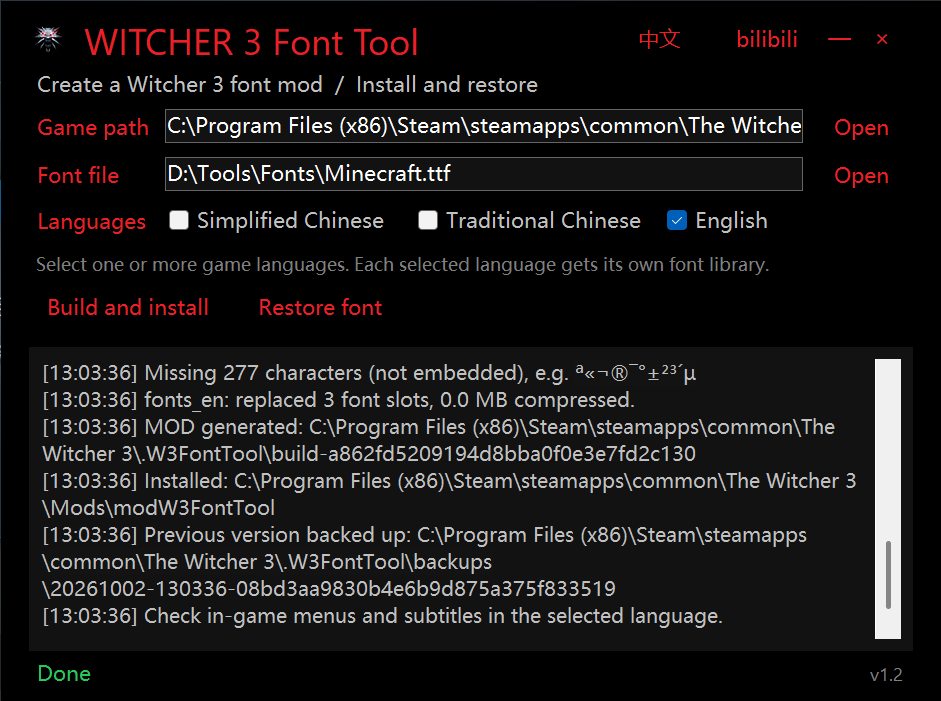
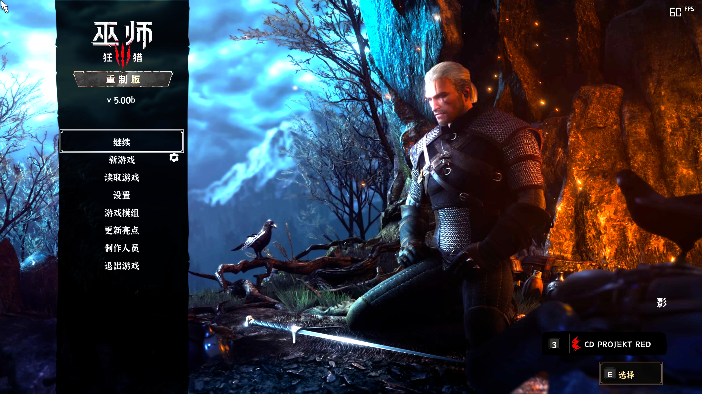

# Witcher3FontTool

[中文](#中文) | [English](#english)

> 测试分支 / Test branch: `codex/font-composition-cyrillic-beta`。新增西里尔文字与中英字体组合请下载 [v1.4.0-beta.1 预发布版](https://github.com/jakeouyang/Witcher3FontTool/releases/tag/v1.4.0-beta.1)，并阅读 [测试说明 / Testing notes](docs/testing-release.md)。游戏内视觉效果仍需验证。

<a name="中文"></a>

## 中文

非官方的《巫师 3：狂猎》次世代版（4.0+）字体 MOD 生成器。选择主字体，可选另一字体用于英文与数字，生成一个 MOD 安装到游戏 `Mods` 目录。支持简体中文、繁体中文、英文、俄语和乌克兰语游戏字库。

**[⬇ 下载最新版](https://github.com/jakeouyang/Witcher3FontTool/releases/latest)**（Windows x64 单文件，自带 .NET 运行时）


## 截图


*工具界面：选择游戏目录、字体文件与目标语言，一键生成并安装*


*游戏内效果：替换字体后主菜单与 UI 的中文渲染*

### 特性

- **GUI / CLI 双模式**：无参数启动图形界面；完整功能亦可通过命令行使用
- **中英字体组合**：中文与西里尔字母优先使用主字体，拉丁字母、数字、半角标点及常见货币符号优先使用可选第二字体；缺字时尝试另一字体。留空第二字体则全部使用主字体。直接组合各槽位的字形，不导出独立 TTF 文件。
- **记住上次选择**：本机保存游戏目录、两种字体路径、语言勾选状态与中英文界面。测试版保存到 `%LocalAppData%\Witcher3FontTool\settings-beta.json`，首次启动读取正式版 `settings.json`；正式版设置不被测试版覆盖。
- **多语言字体槽位**：简体（fonts_cn，2 槽位）、繁体（fonts_zh，2 槽位）、英文／俄语／乌克兰语（fonts_en / fonts_ru / fonts_ua，各 3 槽位），可多选
- **西里尔字母校验**：所选字体必须覆盖俄语／乌克兰语的必需字母，支持 Ё/ё、Є/є、І/і、Ї/ї、Ґ/ґ
- **字形覆盖智能裁剪**：按 GB2312 / Big5 / ASCII / Latin-1 + 游戏原字符集取并集，缺字自动报告且不会生成空白字形
- **一键安装 / 还原**：自动创建 `Mods` 目录；仅管理本工具生成的 MOD（SHA256 清单校验），还原时绝不触碰其他 MOD
- **安全防护**：游戏运行中拒绝安装/还原；目标已存在时拒绝覆盖；无写入权限时提示
- **单文件发布**：自带 .NET 运行时，解压即用

### 使用

#### GUI

运行 `Witcher3FontTool.exe` → 选择游戏根目录 → 选择主字体 → 可选“英文与数字”字体 → 勾选游戏语言 → 「生成并安装」。英文复选框表示英文游戏字库；中文界面中的英文和数字会直接使用第二字体，不需要额外勾选英文。

#### CLI

```text
Witcher3FontTool.exe install  <游戏目录> <字体文件> [--zh-hans] [--zh-hant] [--english] [--russian] [--ukrainian] [--latin-font <第二字体>]
Witcher3FontTool.exe restore  <游戏目录>
Witcher3FontTool.exe generate <字体文件> <输出目录> [--zh-hans] [--zh-hant] [--english] [--russian] [--ukrainian] [--latin-font <第二字体>]
Witcher3FontTool.exe validate-game <游戏目录>
Witcher3FontTool.exe verify   <bundle 或 swf>
Witcher3FontTool.exe render   <bundle 或 swf> <文本>
```

不指定语言时默认简体 + 英文。安装后需在游戏启动器 / Mods 菜单中启用 MOD，且游戏语言需与所选字体语言一致。

### 构建

需要 [.NET 8 SDK](https://dotnet.microsoft.com/download/dotnet/8.0)（Windows）：

```powershell
dotnet build -c Release
# Release 构建默认输出自包含单文件 exe：
# src/Witcher3FontTool/bin/Release/net8.0-windows/win-x64/Witcher3FontTool.exe
dotnet publish src/Witcher3FontTool -c Release -o publish   # 发布到独立目录
```

推送标签 `v*` 时 CI 会自动构建并发布单文件 exe 到 GitHub Releases。
含 `-beta.*` 的标签会发布为预发布版，不取代最新正式版。测试命令 `--feature-test <新目录>` 检查字体来源、字宽、回退、俄语／乌克兰语资源与原版行距；请使用系统临时目录并在完成后删除测试输出。

### 已知限制

- 仅支持 TrueType 轮廓（TTF/TTC）；OTF/CFF 会明确报错拒绝
- 仅支持 BMP（U+0000–U+FFFF）字符；不处理可变字体轴
- TTC 使用第一个字体面
- 游戏 UI 文字需语言设置为对应语言才会使用相应字体资源
- 任意字体组合的视觉大小与粗细不保证一致；不自动合成粗体或斜体。需在游戏内检查混排和数字布局。
- 两个字体都没有的字符会报告并省略；俄语原字库含有普通字体可能不提供的私用区符号，需游戏内检查。

### 工作原理（简述）

工具读取内嵌的字体库骨架（源自本机游戏资源、已完全移除原字体轮廓数据），将其中所有
DefineFont3 槽位替换为从用户 TTF 转换出的矢量字形（TrueType 二次贝塞尔 → SWF Shape 记录），
再按巫师3 次世代版 bundle 格式打包并写入 metadata 索引。详见 [docs/format-notes.md](docs/format-notes.md)。

### 致谢

- [WolvenKit](https://github.com/WolvenKit/WolvenKit) —— metadata.store 字段布局参考
- 巫师3 中文本地化社区对字体 MOD 格式的探索

### 免责声明

本项目为非官方粉丝工具，与 CD PROJEKT RED 无关。《巫师》是 CD PROJEKT S.A. 的商标。
请使用你拥有合法授权的字体文件；因使用本工具产生的任何问题由使用者自行承担。

<a name="english"></a>

## English

Unofficial font replacement MOD generator for The Witcher 3: Wild Hunt next-gen (4.0+).
Pick a main font and optionally a separate Latin/digits font, then generate one MOD in the game's `Mods` directory. Supports Simplified Chinese, Traditional Chinese, English, Russian and Ukrainian UI font libraries.

**[⬇ Download latest](https://github.com/jakeouyang/Witcher3FontTool/releases/latest)** (Windows x64 single-file, self-contained)

See [screenshots](#截图) above.

### Features

- **GUI and CLI** in one binary
- Combines glyphs from two fonts in the same font slots: CJK/Cyrillic prefer the main font; Latin letters, digits, halfwidth punctuation and common currency symbols prefer the optional font. Missing glyphs try the other source. Leaving the optional font empty preserves single-font behavior. No standalone TTF is exported.
- Remembers both font paths, game folder, language selections and interface language. Beta preferences use `%LocalAppData%\Witcher3FontTool\settings-beta.json` and initially import stable `settings.json` without overwriting it.
- Per-language font slots: Simplified Chinese (fonts_cn, 2 slots), Traditional Chinese
  (fonts_zh, 2 slots), English/Russian/Ukrainian (fonts_en/fonts_ru/fonts_ua, 3 slots each)
- Checks the required Russian/Ukrainian alphabet, including Ё/ё, Є/є, І/і, Ї/ї and Ґ/ґ
- Glyph coverage management against GB2312 / Big5 / ASCII / Latin-1 plus the game's original
  character sets, with a missing-glyph report
- Safe install / restore: SHA256 manifest, never touches other mods, refuses to run while the
  game is running
- Self-contained single-file publish

For mixed Chinese text, select a Chinese main font and a Latin/digits font. This also changes letters and numbers inside the Chinese UI. The English checkbox controls the separate English game library. CLI supports `--russian`, `--ukrainian` and `--latin-font <path>` alongside the existing language flags.

### Build

Requires the [.NET 8 SDK](https://dotnet.microsoft.com/download/dotnet/8.0) on Windows:

```powershell
dotnet build -c Release
# Release builds output a self-contained single-file exe at:
# src/Witcher3FontTool/bin/Release/net8.0-windows/win-x64/Witcher3FontTool.exe
dotnet publish src/Witcher3FontTool -c Release -o publish   # publish to a folder
```

Pushing a `v*` tag makes CI build and attach the exe to a GitHub Release.
Tags containing `-beta.*` publish as prereleases and do not replace the latest stable release.

### Limitations

- TrueType outlines only (TTF/TTC); OTF/CFF is rejected with a clear error
- BMP (U+0000–U+FFFF) characters only; variable font axes are not handled
- The first face of a TTC is used
- The game only uses a font resource when its UI language matches
- Different fonts may have different visual sizes/weights; check mixed text and numeric UI in-game. Bold/italic outlines are not synthesized.
- Characters absent from both fonts are reported and omitted. Russian libraries include private-use symbols not necessarily supplied by ordinary fonts.

### Disclaimer

Unofficial fan tool, not affiliated with or endorsed by CD PROJEKT RED.
The Witcher is a trademark of CD PROJEKT S.A. Use fonts you are licensed to use.

## License

[MIT](LICENSE)
